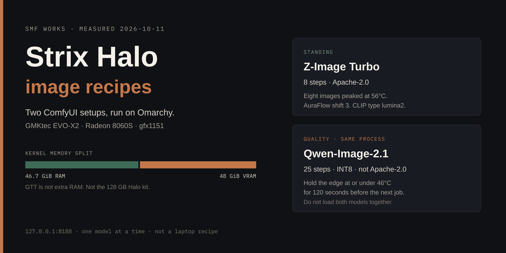

# Strix Halo image recipes

Measured ComfyUI setups for AMD Strix Halo machines running Omarchy. These are the two configurations we actually ran on 2026-10-11. They are not a catalog of models we have only read about.

The box was a GMKtec EVO-X2. Ryzen AI Max+ 395, Radeon 8060S, gfx1151. Omarchy 4.0.4, kernel `7.2.5-3-omarchy`. The kernel saw 46.7 GiB of system RAM and a 48 GiB dedicated VRAM carveout. That is not the AMD Ryzen AI Halo developer kit, and these notes do not tell you to match that kit.

## What is in here

1. [Shared Comfy install](recipes/comfy-omarchy.md) — the Python stack, the wheel that works, and the user service.
2. [Z-Image Turbo](recipes/z-image-turbo.md) — the fast standing model. Eight steps. Apache-2.0.
3. [Qwen-Image-2.1](recipes/qwen-image-2.1.md) — the quality model on the same Comfy process. Twenty-five steps. Not Apache-2.0.
4. [Heat](recipes/thermal.md) — why the second 25-step job fails if you start it too soon.

## What is not in here

No laptop recipe. A desk run with a 48 GiB carveout is not a laptop configuration. We will add a laptop-class guide only after that configuration has been run.

No BIOS change. No Ubuntu reimage. Do not install AMD's OEM kernel 6.14 packages onto this Omarchy kernel.

Do not publish port 8188. Bind `127.0.0.1`. If another machine needs the server, use an SSH tunnel.

One heavy model at a time. Z-Image and Qwen-Image-2.1 do not stay loaded together.

## Licenses

[Tongyi-MAI/Z-Image-Turbo](https://huggingface.co/Tongyi-MAI/Z-Image-Turbo) and the Comfy-Org split we downloaded are Apache-2.0.

[Qwen/Qwen-Image-2.1](https://huggingface.co/Qwen/Qwen-Image-2.1) is not. The model card license field is `other`. Read that card before you redistribute weights or outputs. These guides are for running the model, not for relicensing it.

The text in this repository is MIT. See [LICENSE](LICENSE).
